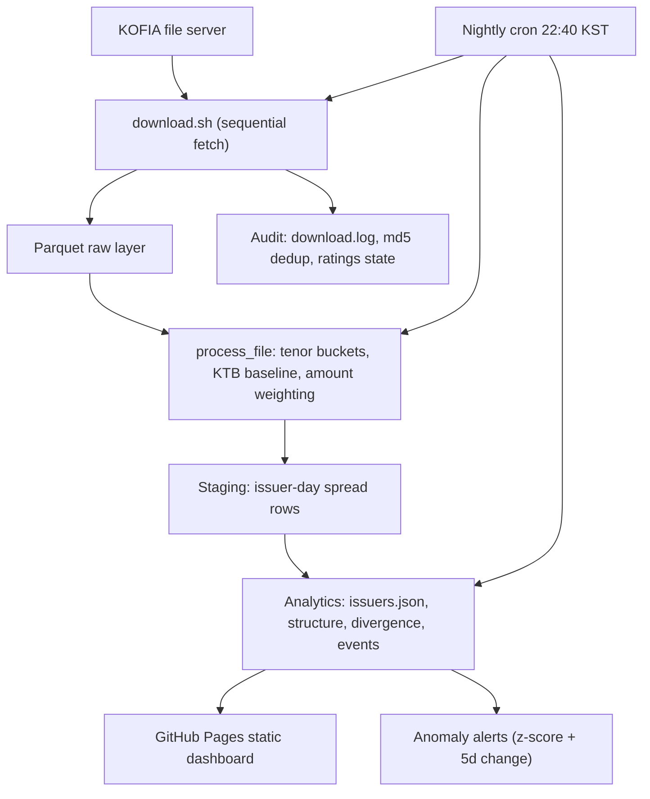

# Corporate Bond Credit Spread Monitor

A local-first data engineering project that ingests Korean over-the-counter
bond trade data (KOFIA), computes issuer-level credit spreads, and serves a
static monitoring dashboard with automated anomaly alerts.

The project implements a complete data engineering workflow using Python,
pandas, PyArrow, cron, and GitHub Pages. It covers incremental and idempotent
ingestion, workflow orchestration, data quality, analytical modeling,
automated verification, and observability.

The current V1 runs on a single VM with a nightly cron and serves a static
site. Airflow orchestration is designed and verified in a local trial but not
yet the production scheduler. A cloud warehouse (PostgreSQL + dbt) migration
is intentionally left as a future enhancement.

Live dashboard: https://sdykim.me/bond-credit-monitor/

## Project context

This is a self-directed data engineering project built to apply
production-oriented practices to public financial data.

Data coverage: 2024-04 through 2026-10, 589 Parquet files. Dashboard data
is current through 2026-10-20 (collector recovery pending, see Current
status).

## Architecture



## Main features

- Incremental ingestion of one new daily file per trading day.
- Idempotent downloads: flock, `.part` files with rename on completion,
  md5 deduplication, circuit breaker on repeated failures.
- Sequential fetching with 3-second gaps (server politeness: the file
  server drops connections mid-transfer and does not support Range).
- Issuer-day spreads: 9 tenor buckets, same-bucket KTB median baseline,
  amount-weighted, 5-trading-day rolling median smoothing.
- Noise filter: issuer-days with fewer than 3 trades are dropped.
- Rule-based 13-industry issuer classification with substring-trap
  handling (ordering rules, not just keyword matching).
- Rating-change tracking per bond, confirmed after 2 trading days,
  merged into issuer-level events.
- Anomaly alerts: 90-day z-score above 2.0 and 5-day move of at least
  10bp, with a 7-day cooldown per issuer.
- Nightly cron: fetch, aggregate, track ratings, build, alert.
- Static-site serving on GitHub Pages (near-zero operating cost).
- Verification harnesses for every generated page (syntax check,
  placeholder sweep, headless render check).

## Data sources

| Source | File pattern | Grain | Frequency |
|---|---:|---|---:|
| KOFIA bond trades | `result_today_*.xlsx.parquet` | One row per trade, ~5,900 rows/day | Daily |
| KOFIA bond issues | `kofia_bis_bond_issue_*.csv.parquet` | One row per issue, ~75,600 rows/day | Daily |
| DART financial statements | `dart_financials.json` | Debt ratio, interest coverage per issuer | Annual (2024) |
| Naver stock closes | Per-ticker cache via fchart | Daily closes for 23 listed mappings | On build |
| ECOS market rates | `backtest/ecos_daily.csv` | KTB 3y, corp AA- 3y, BBB- 3y | Reference only, not an input |

Notes: missing files on the source server return HTTP 500, not 404, so
absence is detected by status code, not by listing. ECOS data is used only
for validation, never as a dashboard input.

## Technology stack

- Python (pandas, PyArrow)
- Parquet (Snappy)
- cron (production scheduler)
- Apache Airflow 2.10.5 (DAG designed and verified in a local trial)
- GitHub Pages (static serving)
- Node (generated-page verification harnesses)
- Git

## Project structure

```text
.
├── download.sh               # Idempotent nightly fetch
├── build_issuers.py          # Core transform: issuer-day spreads (shared)
├── build_html.py             # Main dashboard page
├── build_trends.py           # Industry trend page
├── build_structure.py        # Maturity wall + within-rating dispersion
├── build_divergence.py       # Bond-stock divergence page
├── build_events.py           # Event-based market-reaction page
├── build_monthly.py          # Retired monthly page (superseded by events)
├── track_ratings.py          # Per-bond rating-change tracking
├── check_alerts.py           # Anomaly alerts with cooldown
├── build_bonds.py            # Corporate-group contagion helper
├── fetch_dart.py             # DART financials fetch
├── github_pages/             # Built site (main + sub-pages)
├── backtest/                 # ECOS validation, backtests, benchmarks
└── DASHBOARD_SPEC.md         # Dashboard specification
```

## Prerequisites

- Python with pandas and PyArrow (this workspace uses
  `~/workspace/airflow-bond/trial/.venv/bin/python`)
- Node (for generated-page verification)
- Network access to the KOFIA file server for fetching

## Environment configuration

No secrets are required for the core pipeline: all inputs are public
market data. The DART fetch uses an API key supplied by the operator and
is never committed to the repository.

## Running the pipeline

Nightly (production, cron `bond-dashboard-refresh`, 22:40 KST):

```text
download -> build_issuers -> track_ratings -> build_html
  -> build_structure -> build_divergence -> check_alerts
```

Manual run of the core transform and a page build:

```sh
python build_issuers.py
python build_events.py
python build_html.py --github
```

The events builder caches its daily series in
`github_pages/monthly/daily_series_v2.json`, so verdict-only edits
rebuild instantly without another full Parquet pass.

## Services

| Service | Responsibility |
|---|---|
| `bond-data-evening-fetch` (cron, 22:00 KST) | Fetch new daily files |
| `bond-dashboard-refresh` (cron, 22:40 KST) | Aggregate, track ratings, build, alert |
| GitHub Pages | Static dashboard serving |
| Airflow trial (local, port 8080) | `bond_monitor_daily` DAG: design and verification only |

## Data layers

| Layer | Contents | Format |
|---|---|---|
| `raw` | Source data with minimal transformation: KOFIA trade and issue files, DART financials, stock close caches | Parquet, JSON |
| `staging` | Typed, cleaned, standardized intermediates from `process_file`: issuer-day rows (date, issuer, rating, spread, trade count, amount) and tenor rows, after the 3-trade filter and 5-day rolling median | DataFrame (in-memory; persisted via `issuers.json` series) |
| `analytics` | Business-ready outputs: `issuers.json` (spreads, z-scores, latest table), `structure_data.js`, `divergence_data.js`, events payload (inlined into the page) | JSON, JS |
| `audit` | Operational history: `download.log`, `converted_md5.txt`, `.ratings_state.json`, alert cooldown state, ECOS validation files | Log, JSON, CSV |

Layers are file-based, not warehouse schemas: the same raw, staging,
analytics, audit separation as a warehouse project, without a database
server. This is a deliberate cost and simplicity tradeoff for a
single-operator pipeline.

## Execution audit

Each nightly run leaves:

- `download.log`: fetch attempts, failures, and circuit-breaker trips.
- `converted_md5.txt`: md5 of every converted file (the dedup record).
- `.ratings_state.json`: per-bond rating history and confirmed events.
- Alert state: per-issuer cooldown timestamps in `check_alerts.py`.

Example check (last successful fetch):

```sh
tail -5 download.log
grep -c . converted_md5.txt
```

## Data quality

Checks applied in transformation and validation:

- Issuer-days with fewer than 3 trades are dropped (`MIN_TRADES`).
- 5-trading-day rolling median per issuer suppresses single-trade noise.
- Issuer classification rules are order-dependent; regression cases
  (Samsung Securities stays securities, KEPCO stays public corporation,
  Kookmin Bank stays bank) guard the ordering.
- External validation against ECOS: the KTB leg of the pipeline matches
  ECOS with MAE 2.4bp over 588 days, confirming collection and parsing
  accuracy.
- Composition artifacts are identified, not smoothed away: the largest
  single-day market widening (2024-10-24, +18bp) was a composition
  change, not a market move.
- Trade-based medians and evaluated prices (Minpyeong) are different
  statistics: a daily trade-based AA- point cannot reproduce the
  evaluated series, so no such indicator is published.

## Verification

No pytest suite yet (see Future enhancements). Current verification:

- `node --check` on every generated inline script before pushing.
- Placeholder sweep: no leftover `/*..._JSON*/` markers in built pages.
- DOM-stub render harness: every event card, chart trace, and marker
  label renders before a push.
- ECOS cross-validation as a standing data test (see Data quality).
- GitHub Pages propagation check: a 404 right after push is treated as
  deploy lag and re-checked before debugging.

## Observability

- Cron reports only on new files or failure; silent on clean success.
- Alert reports list new rating events and spread alerts only.
- Data files are inlined into built pages (never a separate data file),
  because a cached old data file with a new page renders empty sections.

## Current status

- Dashboard data through 2026-10-20. The GCP-side collector stopped
  producing files after that date; the file server itself is healthy.
  Recovery (new SSH key provisioning) is pending operator action.
- Weekend and no-new-data alert suppression is an open question.

## Future enhancements

- Promote the Airflow `bond_monitor_daily` DAG from trial to production
  scheduler.
- pytest suite for `industry_of`, `process_file`, and alert rules.
- PostgreSQL + dbt migration of the raw, staging, analytics, audit
  layers (the file-based layering is designed to map directly).
- DART financials integrated into the dashboard (pending confirmation).
